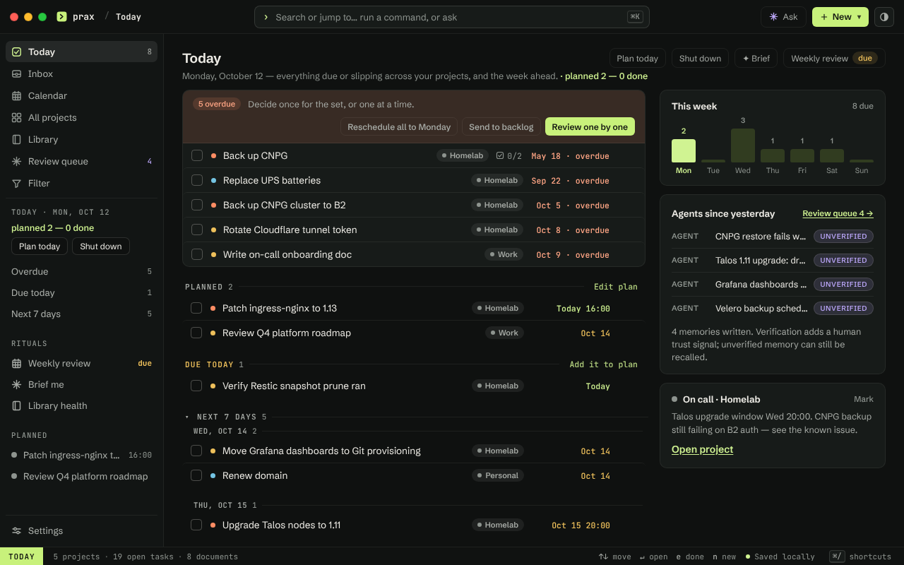

# Prax

Prax (by Moomora) is a local-first app for tasks, runbooks and Markdown notes with a calm,
native-feeling desktop design. A project-scoped task list, board and Today view sit beside a
full-text Markdown library, all in one embedded SQLite file. The same data is shared long-term
memory for AI agents: the `prax` CLI, two portable skills and an optional MCP server let Claude
Code, Codex, Copilot CLI and Antigravity recall prior findings by meaning and file new ones with
provenance.

## Install

Prax ships as a desktop app for **macOS on Apple Silicon** and **Linux x64**. Windows, Intel
Mac and Linux ARM64 installers are not built. Every release on the
[GitHub Releases page](https://github.com/markjoyeuxcom/prax/releases) attaches
`Prax_<version>_aarch64.dmg`, `Prax_<version>_amd64.deb`, `Prax_<version>_amd64.AppImage`,
`Prax-macos-arm64.app.tar.gz` and `SHA256SUMS`, all built and smoke-tested by the release
workflow on GitHub-hosted runners; a release exists only when every package is present. The installers are **unsigned and
not notarized**, so each platform asks you to approve the app once.

**1. Download and verify.** Fetch the package for your platform and `SHA256SUMS` from the
release, then check the download before installing it:

```bash
cd ~/Downloads
shasum -a 256 --ignore-missing -c SHA256SUMS     # macOS
sha256sum --ignore-missing -c SHA256SUMS         # Linux
```

**2. Install.**

- *macOS.* Open the `.dmg` and drag Prax into Applications. The first launch is refused
  because the app is not notarized: Control-click `Prax.app`, choose **Open**, then **Open**
  again in the dialog; or open System Settings ▸ Privacy & Security and choose **Open Anyway**
  beside the Prax notice. From a terminal, `xattr -d com.apple.quarantine /Applications/Prax.app`
  does the same. This is needed once per install.
- *Debian or Ubuntu.* `sudo apt install ./Prax_<version>_amd64.deb`. It pulls in WebKitGTK
  (`libwebkit2gtk-4.1-0`), GTK 3 and the Ayatana app-indicator library, installs the app under
  `/usr/lib/Prax`, and adds a **Prax** entry to the application menu.
- *Any other Linux x64.* `chmod +x Prax_<version>_amd64.AppImage` and run it. An AppImage needs
  FUSE 2 (`libfuse2` on Debian-family systems); without it, run the file with
  `--appimage-extract-and-run`.

**3. First launch.** Prax opens its window and puts an icon in the menu bar or system tray.
There is no account, no sign-in and nothing to configure: the database is one embedded file,
created on first launch at `~/Library/Application Support/com.moomora.prax/prax.db` on macOS or
`~/.local/share/com.moomora.prax/prax.db` on Linux, next to the app's log. Settings ▸ Intelligence
turns on semantic search and AI answers if you want them; both are off by default.

**4. The `prax` CLI and the agent skills (optional).** The bundle ships the installer for the
command-line client and the `prax-recall` / `prax-remember` skills, so one command gives every
agent CLI on the machine long-term memory, with no checkout and no separate Node install:

```bash
# macOS
sh "/Applications/Prax.app/Contents/Resources/resources/app/skills/install.sh" --instructions --cli --hooks
# Linux (.deb)
sh /usr/lib/Prax/resources/app/skills/install.sh --instructions --cli --hooks
```

`--cli` puts `prax` on your PATH, `--instructions` writes the standing memory rule into each
agent's global instructions, and `--hooks` opens every agent session with a Prax briefing and
harvests what agents propose. Details and the other flags: [skills/README.md](skills/README.md).

**Update.** Quit Prax, back up the database (Library ▸ Export ▸ Full workspace backup, or copy
the data directory), install the newer package over the old one, and launch. The data directory
is never replaced; if something is wrong, reinstall the previous package and restore the backup
([docs/backup-restore.md](docs/backup-restore.md)). There is no in-app updater by design.

**Uninstall.** Delete `Prax.app`, or `sudo apt remove prax`, or delete the AppImage; then delete
the data directory above if you also want the database gone. `sh …/skills/install.sh --uninstall`
removes the CLI shim, the skills, the instruction blocks and the hooks.

Building from source, the lifecycle guarantees and the release process are in
[docs/desktop/BUILD.md](docs/desktop/BUILD.md).

**Menu bar and quick capture.** The desktop app lives in the menu bar: closing the main window
hides it and keeps Prax running; reopen it from the Dock or the menu-bar icon and quit from
there or with ⌘Q. **Capture task** (⌘⇧Space) opens a small bar from any app; Enter saves the
text to the Inbox project, with `#project`, `@label`, `!high` and a date word to route it. See
[the desktop guide](docs/desktop/BUILD.md#menu-bar-quick-capture-and-closing-the-window).

**Web server.** Run it with plain Node or Docker Compose; see [Run from source](#run-from-source).

## What it does

- **Projects** (active, on hold, completed, archived) group tasks and documents, with an
  All-projects overview and a cross-project **Today** view of what is due or slipping. The
  protected **Inbox** and **Memory** system projects hold unassigned captures and shared guidance.
- **Tasks** across list, board, backlog and archive views: create, edit, recurrence, snooze,
  archive, restore, permanent delete and drag-and-drop board ordering, with priority, due-date
  and project signals on each card.
- **Calendar**: a month grid of dated tasks, an ICS feed (`GET /api/calendar.ics`) that Apple
  Calendar or Thunderbird can subscribe to, and optional one-way push to a Google Calendar
  ([docs/google-calendar.md](docs/google-calendar.md)).
- **Library**: project-owned runbooks, notes, decisions and references with tags, saved views,
  full-text and optional semantic search, typed links between documents, and an Obsidian-style
  editor (edit, preview, split, focus mode, CodeMirror).
- **Runbook runs**: durable, resumable operational records with snapshotted steps and an
  actor-attributed chronicle that survives deletion of the source document.
- **Inbox processing**: file captures into their owning project, plan them, complete them, turn
  them into references, archive or skip, with guarded undo and optional AI filing suggestions.
- **Trust**: documents written by agents are unverified until a person verifies them; retrieval
  labels unverified memory and keeps it in its own section.
- **AI, optional and local-first**: Ask Prax (cited, trust-aware answers), editor writing
  actions, runbook and post-mortem generation, knowledge-base health scans and natural-language
  capture, over OpenAI, Claude, Gemini, Ollama or llama.cpp.
- **Import, export and backup**: portable JSON task exports, one-way Markdown library export, a
  validated full-workspace backup ZIP and an online SQLite backup command
  ([docs/backup-restore.md](docs/backup-restore.md)).
- **Templates and starter guides** for repository setup, project overviews and onboarding tasks
  ([docs/templates-and-starter-guides.md](docs/templates-and-starter-guides.md)).
- The Console interface: one labelled sidebar, a ⌘K command bar at the centre of the window, a
  status line that names the current mode and the keys that work in it, and on wide windows a
  task inspector docked beside the list. Dark "Graphite" (default) and light "Paper" themes, ten
  accents (lime by default), a reading-size control, and full keyboard operation: ⌘K command
  bar, N capture, list navigation, undo toasts.
- **Tags at scale**: tags are normalised on every write, the Library panel narrows to the tags
  in the current results, and Library ▸ Tags shows usage and suggests merging spellings of one
  subject.

## Screenshots




Regenerate these from a seeded demo server with `node scripts/capture-readme-screenshots.mjs`.

## Run from source

Requirements: Node.js 24 or newer (Prax uses the built-in `node:sqlite` and its online-backup
API) and npm. The stack is Fastify, embedded SQLite, a static plain-JavaScript frontend with
CodeMirror, and a Tauri 2 shell for the desktop.

```bash
git clone git@github.com:markjoyeuxcom/prax.git
cd prax
npm ci
npm run demo        # in-memory seed data at http://127.0.0.1:3100/; resets on restart
```

**Persistent server.** Everything lives in one SQLite file (default `./prax.db`). Migrations
run on startup; `npm run migrate` applies them by hand.

```bash
export PRAX_DB_FILE="$HOME/.local/share/prax/prax.db"
HOST=127.0.0.1 PORT=3100 npm start
```

**Docker Compose.** `docker compose up --build` serves Prax on host-loopback port 3100 with
`prax.db` in the `prax-data` volume; `docker compose down -v` resets it.

**Your own image.** The pipeline builds desktop packages only: no container image is published
(the last one pushed was `v0.30.0`). Build and tag one from `deploy/Dockerfile` and start it
with the image override. The override and the Kubernetes manifests name this checkout's
version, which the release script bumps:

```bash
docker build -f deploy/Dockerfile -t ghcr.io/markjoyeuxcom/prax:v0.44.0 .
docker compose -f compose.yaml -f compose.image.yaml up
```

**Kubernetes.** `deploy/` holds sanitized Kustomize examples (base plus dev, staging and prod
overlays) that keep the database on a PersistentVolumeClaim with a single replica;
`kubectl kustomize deploy/overlays/dev` renders one locally. Any network exposure needs an
authentication boundary in front of Prax: see [docs/deployment.md](docs/deployment.md).

## Configuration

**Network bind.** Prax has no built-in authentication. A non-loopback `HOST` fails closed
unless the operator also sets `PRAX_ALLOW_UNAUTHENTICATED_NETWORK=true`, which acknowledges the
exposure without adding protection; use it only on a trusted network or behind an authenticated
TLS proxy. A loopback bind also refuses requests whose `Host` header is not a loopback name
(the DNS-rebinding defence in `SECURITY.md`), so a same-machine reverse proxy that forwards a
public host name needs the same acknowledgement or that name in `PRAX_ALLOWED_HOSTS`.

**Semantic search** is off by default. The Settings screen can choose a provider, model, URL and
key at runtime (keys are stored in the database and never returned by the API, so treat the
database and its backups as secrets); environment variables set deployment defaults. Embeddings
are stored in SQLite and ranked in process; keyword search (FTS5) always remains available.

| Variable | Default | Purpose |
|----------|---------|---------|
| `EMBEDDING_BACKEND` | `none` | `none`, `ollama`, `openai`, `llamacpp`, `gemini`, `voyage`, or `fake` (tests) |
| `EMBEDDING_MODEL` | — | model name for the chosen backend |
| `OLLAMA_URL` | `http://127.0.0.1:11434` | Ollama base URL |
| `OPENAI_BASE_URL` | `https://api.openai.com/v1` | OpenAI-compatible base URL including `/v1` (OpenAI, llama.cpp, vLLM, LiteLLM) |
| `OPENAI_API_KEY` | — | bearer key for `openai`; omit for keyless local servers |
| `EMBEDDING_QUERY_PREFIX` | — | prepended to search-query embeddings only (instruct-tuned models) |
| `EMBEDDING_SEARCH_MIN_SIMILARITY` | `0.45` | relevance-cutoff floor (cosine similarity) |
| `EMBEDDING_SEARCH_TOP_DROP` | `0.20` | keep results within this of the best match |

**Health checks.** `GET /healthz` confirms the process is alive; `GET /readyz` confirms the
database answers queries.

## Scripts

| Command | Does |
|---|---|
| `npm run demo`, `npm start` | in-memory demo server; SQLite-backed server |
| `npm test`, `npm run check`, `npm run test:e2e` | unit and contract suite; syntax and bundle check; Playwright journeys |
| `npm run migrate` | apply pending database migrations |
| `npm run backup -- --output <file>` | validated online SQLite backup; refuses to overwrite |
| `npm run fixture:quality`, `npm run verify:portable`, `npm run verify:restore` | deterministic workspace fixture and the portability and restore drills ([docs/quality-fixture.md](docs/quality-fixture.md)) |
| `npm run build:codemirror` | rebuild the bundled editor asset |

## Agent memory

The `prax` CLI lets any shell-capable AI tool or person pull a bounded, trust-aware briefing from
project memory, search and read documents, write new memory, and verify or supersede it. The
full guide is [docs/cli.md](docs/cli.md); the convention (what to remember, provenance, trust,
harvesting) is [docs/agent-memory.md](docs/agent-memory.md).

```bash
prax context "how do we restore postgres"          # this project's briefing
prax recall "how do we restore postgres"           # cross-project distilled recall
prax remember "Postgres restore drill" --body "…" --project homelab   # file with the owning project
prax remember "Agent working conventions" --body "…" --memory        # reusable across projects
```

Agent-written documents are unverified until a person clears them with `prax triage`,
`prax verify <id> --as <name>` or the Library UI; both commands refuse to run from an agent's
shell. The same loop ships as the portable `prax-recall` and `prax-remember` skills, one
dependency-free script each, installed from the desktop bundle, from GitHub or as a Claude Code
plugin: see [skills/README.md](skills/README.md). The optional MCP server in `mcp/` exposes the
API to Claude Code as tools: see [mcp/README.md](mcp/README.md). For work on Prax itself, start
with [Working on Prax](docs/working-on-prax.md).

## Documentation

[docs/README.md](docs/README.md) indexes every guide: CLI, agent memory, data formats, backup and
restore, desktop build, deployment, Google Calendar, templates, quality evidence, and the design
notes for the current subsystems.

## Project direction

Product work follows the [product quality standard](docs/design/quality-standard.md): a
regression and invariant ratchet on every change, per-surface excellence gates, ranked critical
journeys, and evidence requirements for people and machine consumers
([docs/quality.md](docs/quality.md) records where that evidence stands). Substantial work starts
as a design note under `docs/design/` and a task in the Prax project. Still open, at a glance:

- an optional "Ask Project" retrieval-plus-generation layer, kept separate from the
  retrieval-only default;
- a `main`/SHA-tagged container image on merge so a dev environment can track a live build;
- app-level authentication, only if a multi-tenant or token model is ever wanted (none by design).

## Security

See [SECURITY.md](SECURITY.md) for the security model (no built-in auth; trusted-network by
design) and how to report a vulnerability.

## Changelog and license

[CHANGELOG.md](CHANGELOG.md) is the release history. MIT, see [LICENSE](LICENSE).

## Repository

GitHub, moved back from GitLab on 2026-10-10 (the GitLab project is archived read-only):

```text
https://github.com/markjoyeuxcom/prax
```
