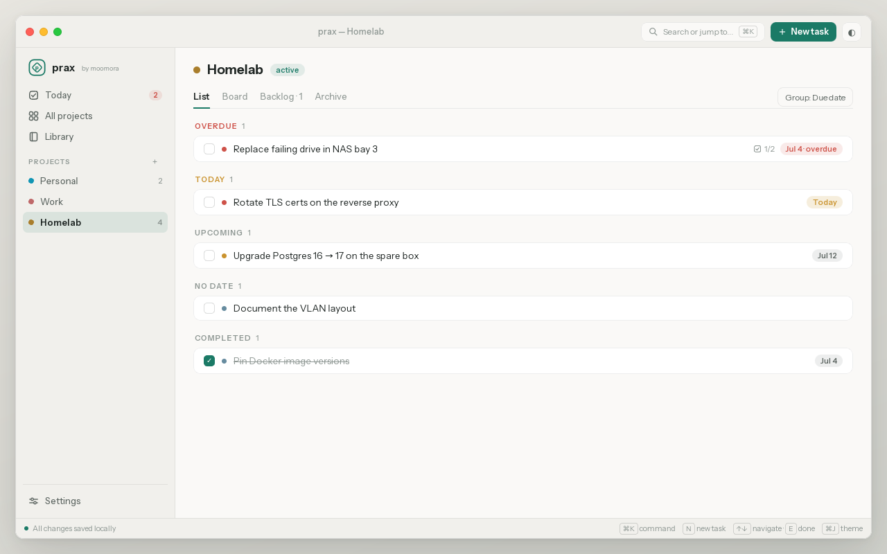
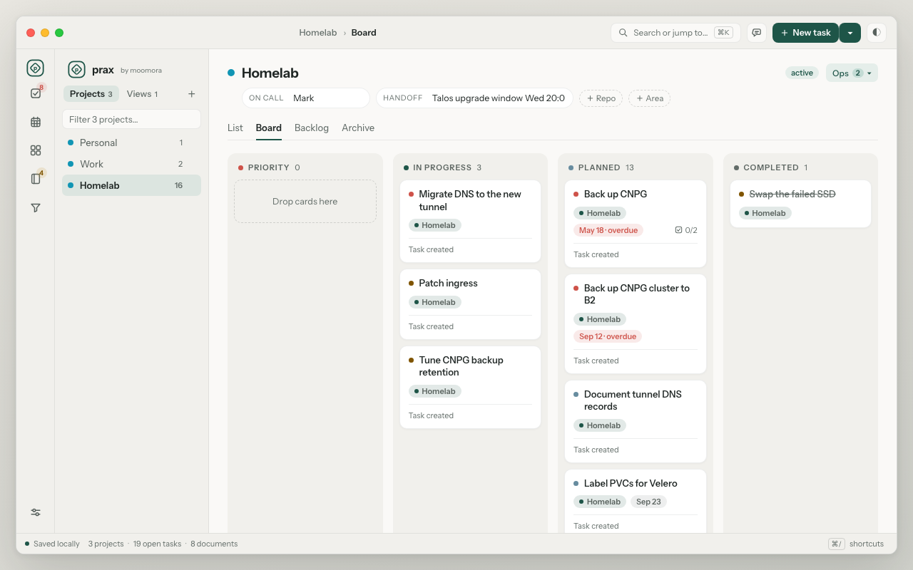
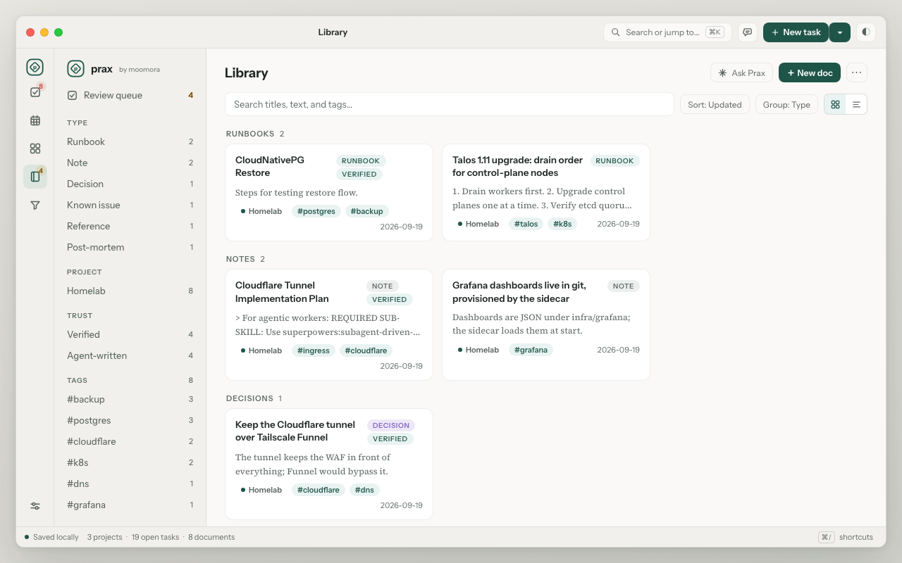
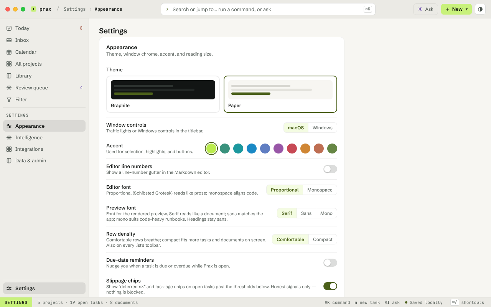

# Prax

Prax (by Moomora) is a local-first app for tasks, runbooks, and Markdown notes, wearing a calm, native-feeling desktop design. It pairs a project-scoped task list and board with a full-text Markdown library — import, export, tags, and archive — all backed by a single embedded SQLite file. An optional local MCP server exposes the same data to Claude Code, turning your tasks and notes into working context for AI-assisted work.

Run it with plain Node (zero external dependencies — the database is an embedded file), with Docker Compose, or on Kubernetes; or try it instantly with the in-memory demo server.

## Install

**Desktop (recommended):** download the installer for your platform from the
[GitLab Releases page](https://gitlab.com/markjoyeuxcom/apps/prax/-/releases) — `.dmg` (macOS
Apple Silicon), `.deb`/`.AppImage` (Linux x64).
Windows, Intel Mac and Linux ARM64 installers are not built or released. Zero external
dependencies: the database is an embedded file, created on first launch. Tagged releases include
SHA-256 checksums. Both packages are built and smoke-tested by the pipeline on the project's own
runners (a Mac and a Linux x64 machine), and a release is only created once every package is
present; the release body lists exactly what was attached (see BUILD.md). Update by quitting
Prax and installing the newer package; the OS app-data directory remains in place. Building,
backup-before-update, rollback, and signing details:
[docs/desktop/BUILD.md](docs/desktop/BUILD.md).

**Menu bar and quick capture:** the desktop app lives in the menu bar. Closing the main window
hides it and keeps Prax running; reopen it from the Dock or the menu-bar icon, and quit from
the menu-bar icon or ⌘Q. **Capture task** (or ⌘⇧Space) opens a small bar from any app: Enter
saves the text to the Inbox project, with `#project`, `@label`, `!high` and a date word to route
it. See [docs/desktop/BUILD.md](docs/desktop/BUILD.md#menu-bar-quick-capture-and-closing-the-window).

**Web server:** run it with plain Node or Docker Compose — see
[Local Install](#local-install) below.

## What It Does

- Organises work into user-creatable **Projects** (active / on-hold / completed / archived) that group both tasks and documents, with an **All projects** overview and a cross-project **Today** view of everything due or slipping.
- Tracks tasks across Tasks, Board, Backlog, and Archive views, with create, edit, archive, restore, permanent delete, and drag/drop board reordering.
- Surfaces at-a-glance board signals: a priority dot, overdue / due-soon date flags, and a project chip on each card in the All-projects view.
- Shows dated tasks on a month **Calendar** (Monday-start grid, day detail strip, month paging) and serves them as an **ICS feed** (`GET /api/calendar.ics`) that Apple Calendar or Thunderbird can subscribe to — all-day and timed events, project categories, `?project=` scoping.
- Links tasks to library runbooks and notes, so operational work points at the documents that support it.
- Provides a cross-project Markdown Library with project-owned runbooks and notes, visible/filterable ownership, destination-selecting import and export dialogs, tags, saved tag views, type/sort/group controls, and full-text search.
- Executes runbooks as durable, resumable operational records with snapshotted steps and an actor-attributed event chronicle that survives source deletion.
- Includes an Obsidian-style editor workspace with edit, preview, split, focus mode, live preview updates, CodeMirror editing, and Markdown helper buttons.
- Ships light ("Porcelain") and dark ("Deep Fern") themes with four accent colours and a reading-size control; fully keyboard-driven — **⌘K command palette**, **quick capture (N)**, list navigation, and undo toasts.
- Moves content through Settings: JSON task import/export (append / skip duplicates / replace-project modes) and scoped Markdown library export. Desktop and supporting browsers let you choose the ZIP destination; full-fidelity recovery uses the SQLite backup runbook.
- Exposes the API to Claude Code through an optional local MCP server for interactive, subscription-backed task and document workflows.
- Acts as **shared long-term memory for AI agents**: the portable `prax-recall` / `prax-remember` skills (Claude Code and Codex) and the `prax` CLI recall prior findings by meaning and persist new ones with agent provenance — see [skills/README.md](skills/README.md) and [docs/agent-memory.md](docs/agent-memory.md).
- Runs locally with plain Node or Docker Compose, or deploys to Kubernetes — the embedded SQLite database needs no separate server.

## Screenshots









## Stack

- Node.js
- Fastify
- Embedded SQLite via `node:sqlite` (no native modules, no database server)
- Static frontend with plain JavaScript modules
- CodeMirror for Markdown editing
- Example Kubernetes manifests under `deploy/` (Kustomize base + overlays)

## Requirements

- Node.js 24 or newer (Prax uses the built-in `node:sqlite` runtime and its online-backup API)
- npm

## Local Install

Clone the repo:

```bash
git clone git@gitlab.com:markjoyeuxcom/apps/prax.git
cd prax
```

Install dependencies:

```bash
npm ci
```

Run the demo server with in-memory seed data:

```bash
npm run demo
```

Open:

```text
http://127.0.0.1:3100/
```

Demo mode is for local UI testing. Data resets when the process restarts.

## Local Persistent Install

Use Docker Compose when you want the app containerised with a persistent data volume:

```bash
docker compose up --build
```

then open http://localhost:3100. Compose provides:

- `app`: the Prax server on host-loopback port `3100` (not published to the LAN)
- `prax-data`: named volume holding `prax.db` (plus its WAL files)

The app applies database migrations automatically on startup, so a fresh volume is
initialised on first run. To reset local data:

```bash
docker compose down -v
```

## Run Your Own Image

The pipeline builds desktop packages only — no container image is published (the last one
pushed was `v0.30.0`). To run a release-style container, build and tag it yourself from
`deploy/Dockerfile`, then use the image override:

```bash
docker build -f deploy/Dockerfile -t registry.gitlab.com/markjoyeuxcom/apps/prax:<tag> .
docker compose -f compose.yaml -f compose.image.yaml up
```

The image override expects:

```text
registry.gitlab.com/markjoyeuxcom/apps/prax:v0.31.1
```

Use source-build Compose for development, and use the published image path when you want to test the same artifact Kubernetes will run.

## Run With Persistence

Prax stores everything in one SQLite file. Choose where it lives (defaults to
`./prax.db` in the working directory):

```bash
export PRAX_DB_FILE="$HOME/.local/share/prax/prax.db"
```

Migrations run automatically on startup; run them manually with:

```bash
PRAX_DB_FILE="$HOME/.local/share/prax/prax.db" npm run migrate
```

Start the server:

```bash
HOST=127.0.0.1 PORT=3100 PRAX_DB_FILE="$HOME/.local/share/prax/prax.db" npm start
```

Prax has no built-in authentication. A non-loopback `HOST` fails closed unless the operator also
sets `PRAX_ALLOW_UNAUTHENTICATED_NETWORK=true`. That acknowledgement does not add protection; use it
only on a deliberately trusted network or behind an authenticated TLS proxy. The normal local and
desktop paths need no acknowledgement because they listen on loopback. A loopback bind also refuses
requests whose `Host` header is not a loopback name (`403`) — the DNS-rebinding defence described in
`SECURITY.md` — so a reverse proxy on the same machine that forwards the public host name needs the
same `PRAX_ALLOW_UNAUTHENTICATED_NETWORK=true` acknowledgement.

Use the validated SQLite snapshot command for an authoritative backup. JSON/Markdown exports in
Settings are portable content formats, not a full database backup — see
[docs/backup-restore.md](docs/backup-restore.md).

## Semantic Search (optional)

Semantic (embedding-based) library search is **off by default**. Environment variables provide
deployment defaults; the single-user Settings screen can also choose a provider, model, URL, and
key at runtime. UI-provided keys are stored in the local SQLite database and are never returned by
the API, so protect the database and its backups as secrets. Embeddings are stored in SQLite and
cosine-ranked in process; no vector extension or separate database service is required. Keyword
full-text search (FTS5) remains available when embeddings are off or unreachable.

| Variable | Default | Purpose |
|----------|---------|---------|
| `EMBEDDING_BACKEND` | `none` | `none` (off), `ollama`, `openai`, `llamacpp`, `gemini`, `voyage`, or `fake` (tests) |
| `EMBEDDING_MODEL` | — | model name for the chosen backend (e.g. `qwen3-embedding:0.6b`, `text-embedding-3-small`) |
| `OLLAMA_URL` | `http://127.0.0.1:11434` | Ollama base URL (when `EMBEDDING_BACKEND=ollama`) |
| `OPENAI_BASE_URL` | `https://api.openai.com/v1` | OpenAI-compatible base URL incl. `/v1` — real OpenAI, llama.cpp, vLLM, LiteLLM, … |
| `OPENAI_API_KEY` | — | bearer key for `openai`; omit for keyless local servers |
| `EMBEDDING_QUERY_PREFIX` | — | prepended to **search-query** embeddings only (instruct-tuned models); e.g. `nomic`'s `search_query: ` |
| `EMBEDDING_SEARCH_MIN_SIMILARITY` | `0.45` | relevance-cutoff floor (cosine similarity) |
| `EMBEDDING_SEARCH_TOP_DROP` | `0.20` | keep results within this of the best match |

Example (OpenAI-compatible server, e.g. a local llama.cpp started with `--embeddings`):

```bash
EMBEDDING_BACKEND=openai OPENAI_BASE_URL=http://127.0.0.1:8001/v1 EMBEDDING_MODEL=nomic-embed-text npm start
```

## Scripts

```bash
npm run demo
npm start
npm test
npm run check
npm run migrate
npm run backup -- --output /safe/path/prax-backup.db
npm run fixture:quality -- --profile ci --output /tmp/prax-quality-ci.db
npm run verify:portable
npm run verify:restore
npm run build:codemirror
```

- `npm run demo` starts the in-memory local demo server.
- `npm start` starts the SQLite-backed server.
- `npm test` runs backend and frontend unit tests.
- `npm run check` syntax-checks key server and browser entry points.
- `npm run migrate` applies pending database migrations.
- `npm run backup -- --output <file>` creates and validates a coherent online SQLite backup; it
  refuses to overwrite an existing destination.
- `npm run fixture:quality` creates or verifies a deterministic mature-workspace fixture; see
  [docs/quality-fixture.md](docs/quality-fixture.md).
- `npm run verify:portable` proves the complete task/checklist portable contract against a fresh
  instance using that mature fixture.
- `npm run verify:restore` destroys and restores disposable `large`/historical mature workspaces,
  then verifies integrity, semantics, migration, the latest WAL write, and production app boot.
- `npm run build:codemirror` rebuilds the bundled CodeMirror editor asset.

An optional local MCP server lives in `mcp/` — it exposes the Prax API to Claude Code so
you can query and edit tasks and documents interactively on a Claude subscription. See
[mcp/README.md](mcp/README.md).

## Shared Memory CLI

The `prax` CLI lets any shell-capable AI tool or human pull a bounded, trust-aware context
pack from project memory, search and read documents, write new memory, and verify or supersede
it. `npm link` in the repo gives a global `prax` command. See [docs/cli.md](docs/cli.md)
for the full guide.

```bash
prax context "how do we restore postgres"          # this project's briefing
prax recall "how do we restore postgres"           # cross-project distilled recall
prax remember "Postgres restore drill" --body "…" --memory   # write to the shared memory namespace
```

Documents written by agents (via the CLI or MCP) are **unverified** by default. A human runs
`prax verify <id> --as <name>` in an attended terminal (or uses the Library UI) to bless them.
Retrieval is active-only and keeps unverified memory in a
clearly-labelled section so AI tools can see it while treating it with appropriate caution.

### Agent memory skills

For agent CLIs the same memory loop ships as two portable skills, `prax-recall` and
`prax-remember`, which Claude Code and Codex load on demand. Each is one dependency-free Node
script that talks to the running app; a checkout of this repo already has them linked in, and
any other machine installs them with one command and no checkout. See
[skills/README.md](skills/README.md) for installation and [docs/agent-memory.md](docs/agent-memory.md)
for the memory convention (what to remember, provenance, supersede).

## Backup & Restore

See [docs/backup-restore.md](docs/backup-restore.md) for backup, restore, and upgrade procedures.
The reproducible workspace and semantic verifier used by restore drills are documented in
[docs/quality-fixture.md](docs/quality-fixture.md).

## Import And Export

Portable task exports use the current Prax format (they carry tasks and checklists, not history,
links, or project metadata — an authoritative backup is a SQLite snapshot, see
[docs/backup-restore.md](docs/backup-restore.md)):

```json
{
  "format": "moomora.tasks",
  "version": 1,
  "project": "homelab",
  "tasks": []
}
```

Import modes:

- `skip`: default mode, skips duplicate tasks by title, project, status, and due date.
- `append`: imports everything as new tasks.
- `replace`: clears the selected project and imports the file after confirmation.

Settings names the task destination explicitly. Browser imports use an exact-once operation UUID,
so retrying after a lost response cannot duplicate an append or repeat a replacement.

Library Markdown export is currently one-way. **Import Markdown…** opens a dialog where the
destination project is selected explicitly before one or more files are submitted. Each file becomes
a project-owned source note; intake preserves its body and filename but does not restore Prax front
matter, type, provenance, trust, or document links. Interrupted per-file creates can be retried
without duplication. Use the SQLite backup/restore runbook for full-fidelity workspace recovery.

Legacy TaskBoard export envelopes are not supported. This project is treated as a greenfield Prax app.

## Data Formats

The portable task format (`moomora.tasks`), one-way library `.md` export front matter, and the
MCP tool surface are documented in [docs/contract.md](docs/contract.md). Prax is
pre-1.0 and these shapes are still evolving; a regression-test suite under `tests/contract/`
locks the current shapes so changes are made deliberately rather than by accident. The HTTP API
is internal and may change between releases — for durable integration prefer the export formats
or the MCP server.

## Kubernetes Deployment

Deployment manifests use a Kustomize **base + overlays** layout under `deploy/`, designed for GitOps
with Argo CD:

```text
deploy/base/                          # env-agnostic manifests (no namespace or exposure)
deploy/overlays/{dev,staging,prod}/   # per-env image tag
```

These are **sanitized example manifests**. A GitOps tool such as Argo CD renders `deploy/overlays/<env>`
into a namespace like `prax-<env>`; no manifest hard-codes a namespace.

Each environment provisions a `PersistentVolumeClaim` (`prax-data`) that holds the embedded
SQLite database at `/data/prax.db` (`PRAX_DB_FILE`); the Deployment uses a `Recreate` strategy
and a single replica because SQLite is single-writer. The rendered base creates only a ClusterIP
Service. The opt-in `HTTPRoute` example must be placed behind authentication and TLS before use.

Render any environment locally (no cluster needed):

```bash
kubectl kustomize deploy/overlays/dev
```

See [docs/deployment.md](docs/deployment.md) for the full notes, including the required
authentication boundary for any network exposure.

## Health Checks

- `GET /healthz` confirms the Node process is alive.
- `GET /readyz` confirms the embedded database answers queries.

## Project Direction

Product work is governed by the
[Exceptional Prax quality standard](docs/superpowers/specs/2026-07-13-exceptional-prax-quality-standard.md),
which defines the immediate regression/invariant ratchet, per-surface excellence gates, ranked
critical journeys, and evidence requirements for both people and machine consumers.

The detailed, living backlog lives in [docs/ROADMAP.md](docs/ROADMAP.md). The shared-memory
direction (trust loop in the UI and MCP, the retrieval eval harness, external references,
repo-URL project detection, and the portable memory skills) has shipped. What remains, at a glance:

- an optional "Ask Project" RAG layer, kept separate from the retrieval-only default
- a `main`/SHA-tagged container image on merge so a dev environment can track a live build
- app-level authentication, only if a multi-tenant or token model is ever wanted (none by design today)

## Security

See [SECURITY.md](SECURITY.md) for the security model (no built-in auth; trusted-network by
design) and how to report a vulnerability.

## Changelog

See [CHANGELOG.md](CHANGELOG.md) for the release history.

## License

MIT. See [LICENSE](LICENSE).

## Repository

GitLab (moved from GitHub on 2026-09-07; the GitHub copy is retained read-only):

```text
https://gitlab.com/markjoyeuxcom/apps/prax
```
